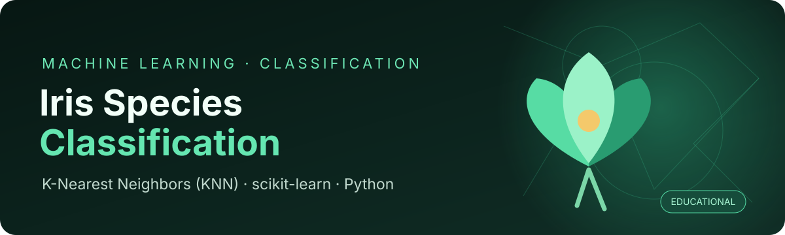
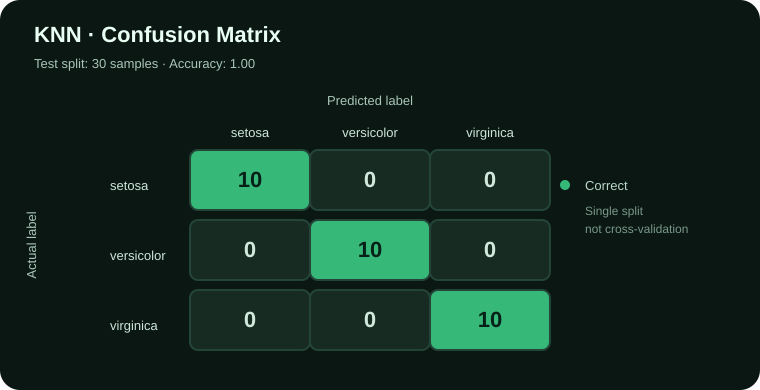

# Iris Species Classification

<p align="center"></p>

A beginner-friendly machine learning project using **K-Nearest Neighbors (KNN)** to classify Iris flowers into three species from four measurements.

> **Project status:** Educational learning project. Run the notebook to reproduce results; no performance score is claimed here.

## Overview

The project uses scikit-learn's built-in Iris dataset. Each sample has sepal length, sepal width, petal length, and petal width. A KNN classifier with `n_neighbors=5` is trained to predict one of three species.

## Workflow

1. Load the dataset with scikit-learn.
2. Create a pandas DataFrame with feature names and target labels.
3. Split data into training and test sets (80/20).
4. Train a KNN classifier with five neighbors.
5. Predict test labels and try a sample prediction.

## Tech stack

- Python
- pandas and NumPy
- scikit-learn
- Jupyter Notebook

## Getting started

```bash
git clone https://github.com/amirreza91-13/iris-species-classification.git
cd iris-species-classification
python -m venv .venv
```

Activate the environment, then install dependencies.

**Windows PowerShell**
```powershell
.venv\Scripts\Activate.ps1
pip install -r requirements.txt
```

**macOS / Linux**
```bash
source .venv/bin/activate
pip install -r requirements.txt
```

Launch Jupyter with `jupyter notebook`, open `j2.ipynb`, and run the cells in order.

## Evaluation results

The notebook was executed with a stratified 80/20 train/test split (`random_state=42`) and `KNeighborsClassifier(n_neighbors=5)`. On this single split, the model achieved **100% accuracy (30/30 test samples)**. Each class had 10 test samples and all were classified correctly.



This is a result from one holdout split, not a guarantee of generalization. Cross-validation and feature-scaling experiments are useful next steps.

## Example prediction

The notebook predicts a species for a sample with measurements `[5, 2, 3, 1]`. The predicted class depends on the fitted model and train/test split.

## Next improvements

- Set `random_state` for reproducible splitting.
- Add accuracy, precision/recall, and a confusion matrix.
- Compare several values of `k`.
- Scale features using a pipeline and evaluate the impact.
- Add plots generated by the notebook.

## Dataset

The Iris dataset is included with scikit-learn, so no separate download is required.

## Disclaimer

This is an educational demonstration, not a production classifier.

---
Made by [amirreza91-13](https://github.com/amirreza91-13).
